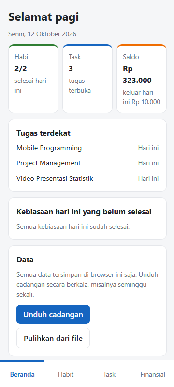
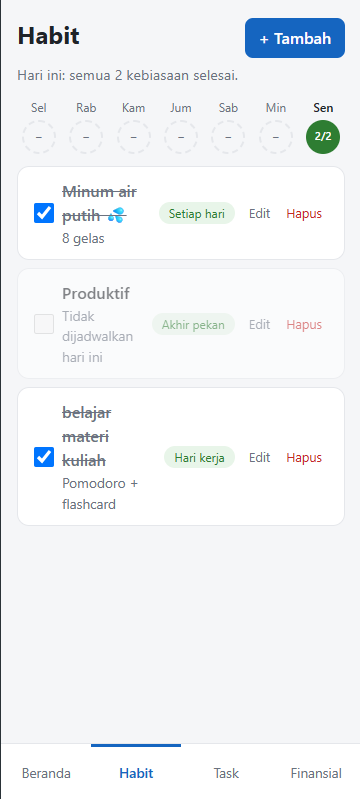
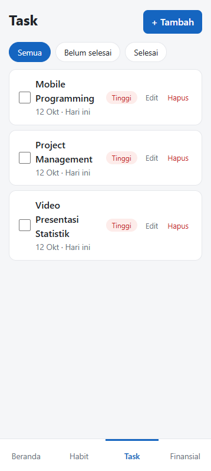
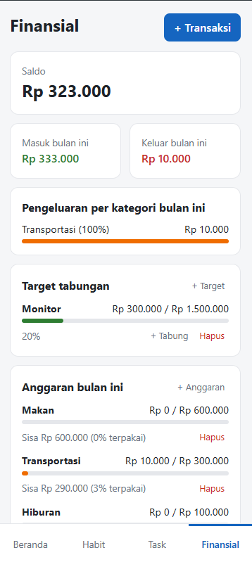

# Dayflow

Aplikasi web pribadi untuk mengatur **tugas**, **kebiasaan**, dan **keuangan** dalam satu halaman. Dibuat dengan HTML, CSS, dan JavaScript murni, tanpa framework dan tanpa server, sebagai proyek belajar pemrograman web.

**Coba langsung:** https://asidez-6.github.io/dayflow/

## Tampilan

| Beranda | Habit | Task | Finansial |
| --- | --- | --- | --- |
|  |  |  |  |

## Fitur

**Beranda**
- Sapaan sesuai jam dan tanggal hari ini
- Ringkasan kebiasaan, tugas terbuka, dan saldo, bisa diklik untuk membuka halamannya
- Tiga tugas dengan deadline terdekat dan kebiasaan yang belum selesai hari ini
- Unduh dan pulihkan cadangan data

**Habit**
- Tambah, edit, dan hapus kebiasaan dengan jadwal setiap hari, hari kerja, atau akhir pekan
- Centang kebiasaan hari ini
- Riwayat 7 hari terakhir dalam bentuk bulatan progres

**Task**
- Tambah, edit, hapus, dan centang tugas
- Deadline dan prioritas (tinggi, sedang, rendah)
- Urut otomatis menurut deadline, tugas yang lewat deadline ditandai merah
- Filter Semua, Belum selesai, dan Selesai

**Finansial**
- Catat pemasukan dan pengeluaran per kategori
- Saldo, total masuk dan keluar bulan ini
- Pengeluaran per kategori dengan persentase
- Target tabungan dengan progres
- Anggaran bulanan per kategori, berubah merah kalau terlewati

## Teknologi

- HTML5
- CSS3 (flexbox, grid, variabel CSS, mobile-first)
- JavaScript tanpa framework
- `localStorage` untuk menyimpan data di browser

## Cara menjalankan

**Cara termudah:** buka https://asidez-6.github.io/dayflow/ di browser HP atau laptop.

**Di komputer sendiri:**

```
git clone https://github.com/asidez-6/dayflow.git
```

Lalu buka `index.html` di browser, atau gunakan ekstensi Live Server di VS Code.

## Tentang data

- Semua data tersimpan di `localStorage` browser yang dipakai. Tidak ada data yang dikirim ke server mana pun.
- Data di setiap browser dan perangkat terpisah. Gunakan **Unduh cadangan** dan **Pulihkan dari file** di Beranda untuk memindahkan data.
- Menghapus data situs di pengaturan browser juga menghapus data Dayflow, jadi unduh cadangan secara berkala.

## Rencana pengembangan

- [ ] Mencentang kebiasaan untuk hari sebelumnya
- [ ] Mengedit transaksi
- [ ] Kategori pengeluaran yang bisa ditambah sendiri
- [ ] Mode gelap

## Tentang proyek ini

Dibuat oleh [asidez-6](https://github.com/asidez-6) sebagai proyek belajar. Aplikasi dikerjakan bertahap dalam 15 langkah, mulai dari kerangka HTML, tampilan dasar, lalu fitur Task, Habit, Finansial, Beranda, sampai cadangan data. Riwayat commit repo ini mengikuti langkah-langkah tersebut.